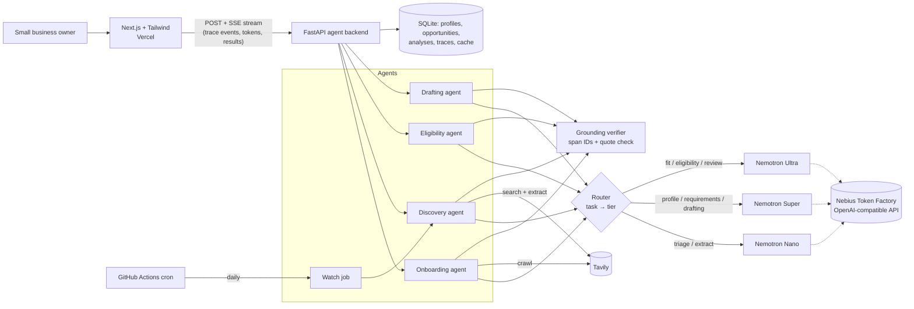

# BidScout

**An AI agent that finds, qualifies, and drafts responses to government contracts for small businesses.**
Built on **NVIDIA Nemotron** (Nano, Super, Ultra) via **Nebius Token Factory**, with live web data from **Tavily**.

[](LICENSE)
[](https://github.com/Yashika2211/Nebius-ai-hack/actions/workflows/ci.yml)

- **Live demo:** _coming soon_
- **Demo video:** _coming soon_
- **Track:** Best Apps and Agents, Nebius x NVIDIA Global AI Hackathon

---

## The problem

The US government sets aside billions of dollars in contracts for small businesses every year, including
women-owned, veteran-owned, HUBZone, and 8(a) firms. Most of the businesses that qualify never bid. Finding
a relevant solicitation across SAM.gov and dozens of state and city portals, checking eligibility (set-asides,
size standards, bonding, insurance, deadlines), and writing a compliant response takes days of specialist
work. A 40-person janitorial company has no proposal team.

## What BidScout does

| Step | What happens | Model |
|---|---|---|
| **1. Onboard** | Crawls the company website (Tavily **crawl**) and builds a profile: NAICS codes, certifications, past performance, capabilities. **Every fact links to the sentence it came from.** Facts it can't trace back to a source get dropped and are shown as dropped. | Nemotron **Super** |
| **2. Discover** | Plans searches from the profile and searches SAM.gov plus state and city portals (Tavily **search**). Triages every hit in one batch, reads the top solicitations in full (Tavily **extract**), and ranks them with a **transparent fit score**. | **Nano** triages and extracts, **Ultra** scores fit |
| **3. Qualify** | Extracts disqualifying requirements (set-asides, bonding, clearances, insurance, deadlines) and decides met, not met, or unknown for each one, **citing the RFP text and the profile evidence**. Set-aside and deadline checks are deterministic code. | **Super** extracts, **Ultra** decides |
| **4. Draft** | Builds a **compliance matrix** (every "shall/must" mapped to a response section, gaps flagged) and streams a first-draft capability statement where **every sentence carries citations**. Ultra then does a final compliance review. | **Super** drafts, **Ultra** reviews |
| **5. Watch** | Re-scans daily for every saved company and surfaces only new matches. | Same pipeline |

The **agent trace panel** shows every model call live: which Nemotron tier ran it, why, latency, tokens,
and cost. It also shows the measured **"Routing saved X% vs. Ultra-only"** number.

## Architecture



**Request flow.** Each agent step runs in a worker thread. Every LLM and tool call is recorded to a trace
and pushed onto the Server-Sent Events stream as it happens, so the UI updates live and drafts stream token
by token.

## How we used Nemotron + Token Factory

**1. Multi-model routing, visible in the product.** Every LLM call goes through one function,
`llm.chat(task, ...)` ([backend/app/llm.py](backend/app/llm.py)). The router
([backend/app/router.py](backend/app/router.py)) maps each task to the cheapest Nemotron tier that does it well:

| Task | Tier | Why |
|---|---|---|
| `discover.queries` | Nano | Short query generation from a known profile |
| `discover.triage` | Nano | High-volume yes/no relevance filter on search hits |
| `discover.extract` | Nano | Pull title, agency, dates, NAICS from an RFP page |
| `profile.extract` | Super | Structured extraction from messy marketing pages |
| `eligibility.requirements` | Super | Long-document requirement extraction |
| `draft.matrix` / `draft.statement` | Super | Requirement mapping and long-form grounded drafting |
| `discover.fit` | Ultra | Multi-factor judgment that decides what the user pursues |
| `eligibility.decide` | Ultra | Dealbreaker reasoning: set-asides, bonding, clearances |
| `draft.review` | Ultra | Final compliance review |

**2. Confidence-based escalation.** Nano triages search results in one batched call. Any result with confidence
below 0.6 is re-checked on Super, so cheap calls cover the easy cases and a bigger model covers the hard ones.

**3. Measured routing savings, not estimated.** Each call records real `prompt_tokens` and `completion_tokens`
from the API response. The trace computes actual cost against the cost of the same tokens on Ultra, and the
eval harness runs the whole pipeline in a forced **Ultra-only mode** to compare *quality* as well as cost
(see [Evaluation](#evaluation)).

**4. Model IDs discovered, not hardcoded.** At startup BidScout calls `GET /v1/models` on Token Factory and
picks the Nano, Super and Ultra IDs by pattern ([backend/app/models.py](backend/app/models.py)). They can be
pinned with `MODEL_NANO`, `MODEL_SUPER` and `MODEL_ULTRA`.

**5. JSON-mode structured output with repair.** Extraction tasks use `response_format={"type": "json_object"}`,
strip any `<think>` reasoning blocks, and retry once with a repair prompt if the JSON doesn't parse.

**6. Streaming.** Drafting uses `stream=True` with `stream_options.include_usage`, so the draft appears live
while token accounting stays exact.

## Grounding: no unsupported claims

Sources (website pages, owner notes, RFP text, the profile itself) are split into numbered spans such as
`[rfp:12]` and `[profile:3]`. Models must cite span IDs **and** a short verbatim quote. The verifier
([backend/app/grounding.py](backend/app/grounding.py)) then:

- rejects citations to spans that don't exist,
- rejects quotes that don't appear in the cited span (exact match or ≥70% content-word overlap),
- **drops** unsupported profile facts and shows them in a "dropped" list,
- **downgrades** an eligibility "met" with no profile evidence to "unknown",
- counts an ungrounded fit-score factor at **half weight**,
- marks draft sentences without valid citations, and reports a grounding rate for the whole draft.

The fit score is transparent by construction. The model scores six factors, and fixed weights in code combine
them ([backend/app/scoring.py](backend/app/scoring.py)). Deterministic caps apply: an expired deadline scores 0,
and failing the set-aside caps the score at 20.

## Tavily: search, extract and crawl each do a different job

| Endpoint | Where | Why this one |
|---|---|---|
| **crawl** | Onboarding | A company's NAICS codes, certifications and past performance are spread across About, Services and Projects pages. Crawl with natural-language `instructions` walks the site and returns only those pages, so the profile isn't limited to the homepage. |
| **search** | Discovery | `include_domains` restricted to SAM.gov and 12 state and city procurement portals, with `search_depth=advanced`. That finds live solicitations rather than news about them. |
| **extract** | Qualify and draft | Search snippets aren't enough to check a bonding requirement. Extract pulls the full solicitation text, which is then split into spans, so every requirement and "shall" statement cites the real RFP language. |

Every Tavily response is cached. Demo mode replays cached responses if a live call fails.

## Evaluation

[backend/evals/run_eval.py](backend/evals/run_eval.py) runs extraction, fit scoring, and eligibility on
hand-labeled real solicitations, once with routing and once in Ultra-only mode.

_Results table will be added after the eval run._

```bash
cd backend
python -m evals.collect <solicitation URLs>   # saves text; labels are filled in by hand
python -m evals.run_eval                      # writes evals/results.md
```

## Setup

**Requirements:** Python 3.11+, Node 20+, a [Nebius Token Factory](https://tokenfactory.nebius.com/) API key,
and a [Tavily](https://app.tavily.com/) API key (free tier).

```bash
git clone https://github.com/Yashika2211/Nebius-ai-hack.git
cd Nebius-ai-hack
cp .env.example .env        # add NEBIUS_API_KEY and TAVILY_API_KEY
```

**Backend**

```bash
cd backend
python -m venv .venv && source .venv/bin/activate
pip install -r requirements.txt
uvicorn app.main:app --reload --port 8000
```

**Frontend**

```bash
cd frontend
cp .env.example .env.local  # NEXT_PUBLIC_API_URL=http://localhost:8000
npm install
npm run dev                 # http://localhost:3000
```

Open http://localhost:3000 and click **Try the demo company**, or onboard your own.

**Tests**

```bash
cd backend && python -m pytest -q
```

These cover routing, cost math, grounding verification, scoring caps, set-aside logic, and an end-to-end golden
path with Token Factory and Tavily faked at the network boundary.

### Demo reliability

`DEMO_MODE=auto` (the default) caches every Token Factory and Tavily response. If a live call fails, or a key
is missing, the cached response is served and marked `cache` in the trace. `python -m app.seed export` saves a
real run to `backend/seed/`, so the deployed demo always has a working golden path.

## Deployment

- **Backend:** Render free tier via [render.yaml](render.yaml) (Docker), with no card required.
- **Frontend:** Vercel, root directory `frontend`, env `NEXT_PUBLIC_API_URL=<backend URL>`.
- **Watch mode:** [.github/workflows/watch.yml](.github/workflows/watch.yml) calls `POST /api/watch/run-all`
  daily with a shared `WATCH_TOKEN`.

## Other Nebius services used

**Nebius Token Factory** is the only Nebius service in the current build. We designed the daily watch job
to run on **Nebius Serverless Jobs** (it is a stateless `python -m app.watch` entry point). For the hackathon
we run it on a free GitHub Actions cron, to avoid needing a payment method on a new cloud account.

## Feedback on Token Factory / Nemotron

_Being written as we build. Observations so far:_

- **The quickstart doesn't list model IDs.** The docs quickstart shows a single example model, and the
  Nemotron IDs aren't on a public page. We had to call `/v1/models`, and third-party listings disagree on
  casing (`nvidia/nemotron-3-super-120b-a12b` vs `nvidia/NVIDIA-Nemotron-3-Nano-30B-A3B`). A public,
  copyable model table with exact IDs, context length and price would save every new user a step.
- **The pricing page needs a login.** The prices page redirects to the authenticated console, so you can't
  estimate costs before signing up. That matters when you're choosing a tier per task.

## Project structure

```
backend/
  app/
    main.py            FastAPI app, SSE streaming
    llm.py             Token Factory wrapper: routing, tracing, caching, JSON repair, streaming
    router.py          task → Nemotron tier, Ultra-only baseline, savings math
    models.py          resolve model IDs from /v1/models
    grounding.py       spans, citation and quote verification
    scoring.py         transparent weighted fit score
    tavily_client.py   search / extract / crawl
    agents/            profile, discover, eligibility, draft
    watch.py           daily re-scan
    seed.py            demo company + cached replay
  evals/               routed vs Ultra-only harness
  tests/
frontend/
  src/app/             landing, company dashboard, opportunity workspace, runs
  src/components/      TracePanel, FitScore, Citation, EligibilityView, DraftView, …
```

## License

[MIT](LICENSE)
